<p align="center">
  
</p>

<p align="center">
  <a href="../../actions/workflows/windows-build.yml"></a>
  <a href="../../actions/workflows/linux-build.yml"></a>
  <a href="../../actions/workflows/macos-build.yml"></a>
  <a href="LICENSE"></a>
  
  <a href="https://github.com/mrsoundmind"></a>
</p>

<p align="center">
  <a href="../../releases/latest"></a>
</p>

<p align="center">
  <a href="#install-on-mac"><b>Mac</b></a> &nbsp;·&nbsp;
  <a href="#install-on-windows"><b>Windows</b></a> &nbsp;·&nbsp;
  <a href="#install-on-linux"><b>Linux</b></a> &nbsp;·&nbsp;
  <a href="#what-bolke-does"><b>What it does</b></a> &nbsp;·&nbsp;
  <a href="#meetings-who-said-what"><b>Meetings</b></a> &nbsp;·&nbsp;
  <a href="#reminders-and-to-dos"><b>Reminders</b></a> &nbsp;·&nbsp;
  <a href="#building-it-yourself"><b>Build it</b></a>
</p>

<br>

<h3 align="center">Talk to your computer. It types, it takes notes, and it remembers for you.</h3>

<p align="center">Free, open source, and private: your voice never leaves your computer.</p>

<br>

**Bolke** (बोलके, "by speaking") turns your voice into text on Mac, Windows and Linux.

- **Dictate:** hold a shortcut, speak, let go. Your words are typed into whatever app you're using: email, chat, documents, the browser.
- **Capture ideas:** a second shortcut saves what you say as a note instead of typing it.
- **Record meetings:** Bolke writes the meeting out and shows who said what.
- **Set reminders:** say "remind me to call Priya at 5" and Bolke rings you at 5.

Everything runs on your own computer. There's no account, no subscription and no cloud. After the first download it works offline.

<p align="center">
  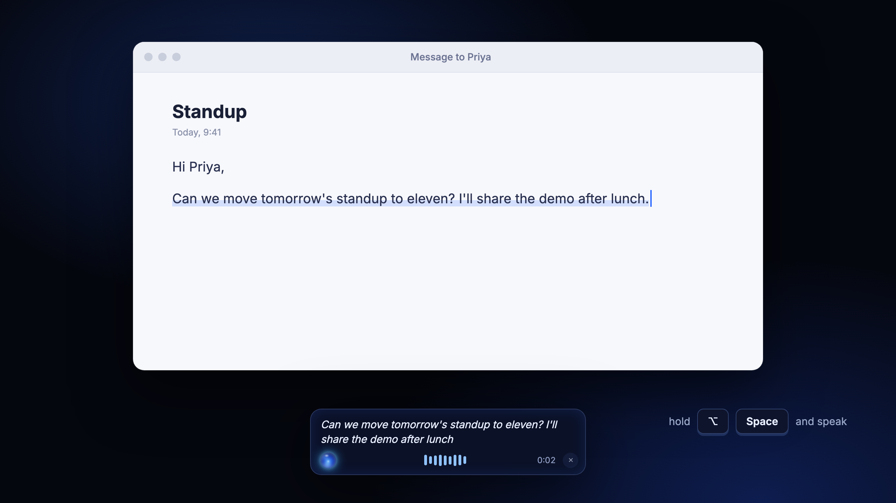
</p>

## What Bolke does

<table>
  <tr>
    <td width="50%" valign="top">
      <h3>🎙️ Dictation</h3>
      Hold the shortcut, speak and let go. Bolke types your words where your cursor is, in any app. A small bubble shows the words as you speak.
    </td>
    <td width="50%" valign="top">
      <h3>💡 Notes and ideas</h3>
      Press the idea shortcut anywhere and say what's on your mind. It's saved in Notes, not typed. Write notes too, and sort them into projects.
    </td>
  </tr>
  <tr>
    <td width="50%" valign="top">
      <h3>👥 Meetings, with who said what</h3>
      Record a call or a meeting room, or add a recording you already have. Bolke writes every line and who said it, and remembers voices you've named.
    </td>
    <td width="50%" valign="top">
      <h3>⏰ Reminders and to-dos</h3>
      Say "remind me…" with either shortcut. Bolke works out the time, rings you then, and keeps a to-do list, including the action points from your meetings.
    </td>
  </tr>
  <tr>
    <td width="50%" valign="top">
      <h3>✨ AI summaries</h3>
      Get a short summary and the action points for any note or meeting, written on your computer by a free AI model.
    </td>
    <td width="50%" valign="top">
      <h3>🔒 Private by design</h3>
      Speech recognition, speaker names, summaries and reminders all run on your computer. Nothing you say is uploaded.
    </td>
  </tr>
</table>

### The shortcuts

|                    |     Mac     |     Windows      |         Linux          |
| ------------------ | :---------: | :--------------: | :--------------------: |
| **Dictate** (hold) | **⌥ Space** | **Ctrl + Space** | **Ctrl + Alt + Space** |
| **Save an idea**   |  **⌥ ⇧ I**  | **Alt + ⇧ + I**  |   **Ctrl + Alt + I**   |

Hold a shortcut to talk, or tap it once to keep listening and tap again to stop. You can change both in Bolke's settings.

## Meetings: who said what

<p align="center">
  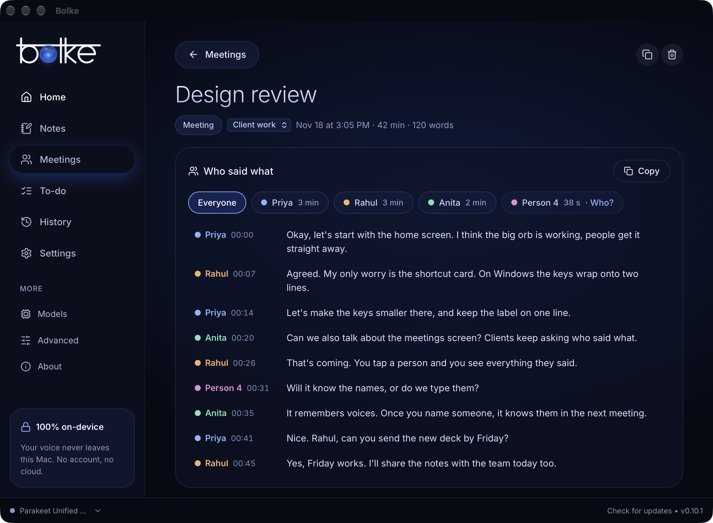
</p>

- **Every line, with its speaker.** Each person gets a name and a colour, and you can see how long each of them talked.
- **Tap a name** to see only what that person said.
- **Name a voice once.** Bolke remembers it and knows that person in your next meeting.
- **Summary and action points** at the press of a button. The action points go to your to-do list.
- **Calls and rooms.** Bolke records through your microphone. On Linux it also records the other people on the call, straight from the computer's sound.
- **Already have a recording?** Click **Add a recording** and Bolke writes it out the same way.

## Reminders and to-dos

<p align="center">
  
</p>

1. Press either shortcut and say "remind me…", for example: _"Remind me to send the invoice tomorrow at 6."_
2. Bolke shows a small bubble with the reminder and its time. Nothing is typed. If you used the dictation shortcut and meant to type those words, click **Type it instead**.
3. At that time you get a notification with a sound, and the bubble comes back with **Done** and **In 10 min**.

Bolke understands everyday ways of saying a time: _in 20 minutes_, _tonight_, _tomorrow at 9_, _on Friday_, _at 5:30_. It understands Hinglish too: _"kal subah 9 baje yaad dilana, domain kharidna hai."_

Say it without a time (_"remind me to buy a pop filter"_) and it's added to your to-do list with no time. You can also type to-dos, change their time, or tick them off on the **To-do** tab.

## Screenshots

<table>
  <tr>
    <td width="50%">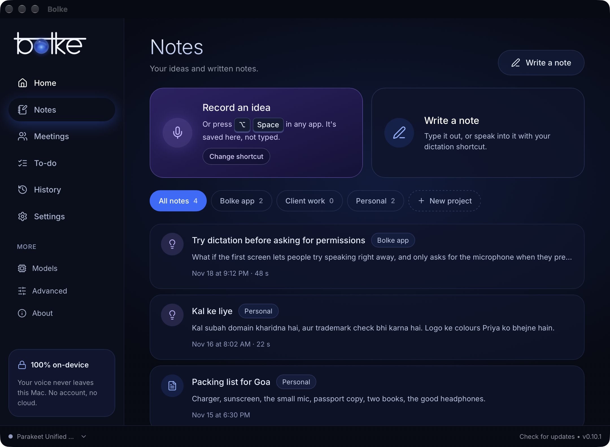</td>
    <td width="50%">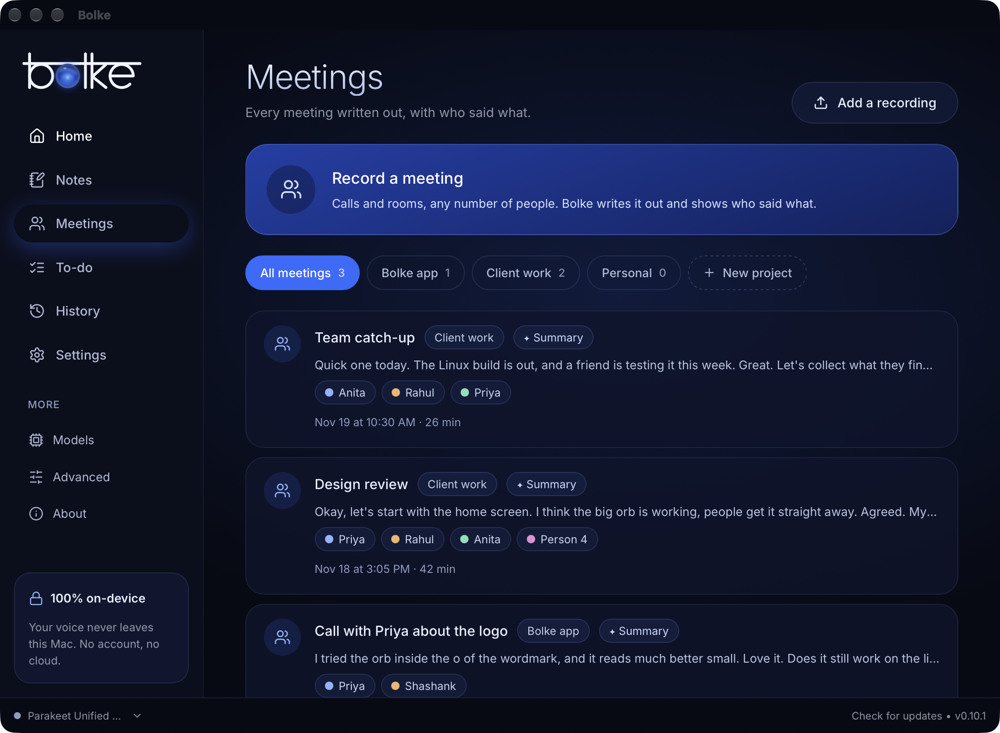</td>
  </tr>
  <tr>
    <td align="center"><sub><b>Notes:</b> spoken ideas and written notes, in projects</sub></td>
    <td align="center"><sub><b>Meetings:</b> every meeting, with who was there</sub></td>
  </tr>
  <tr>
    <td width="50%">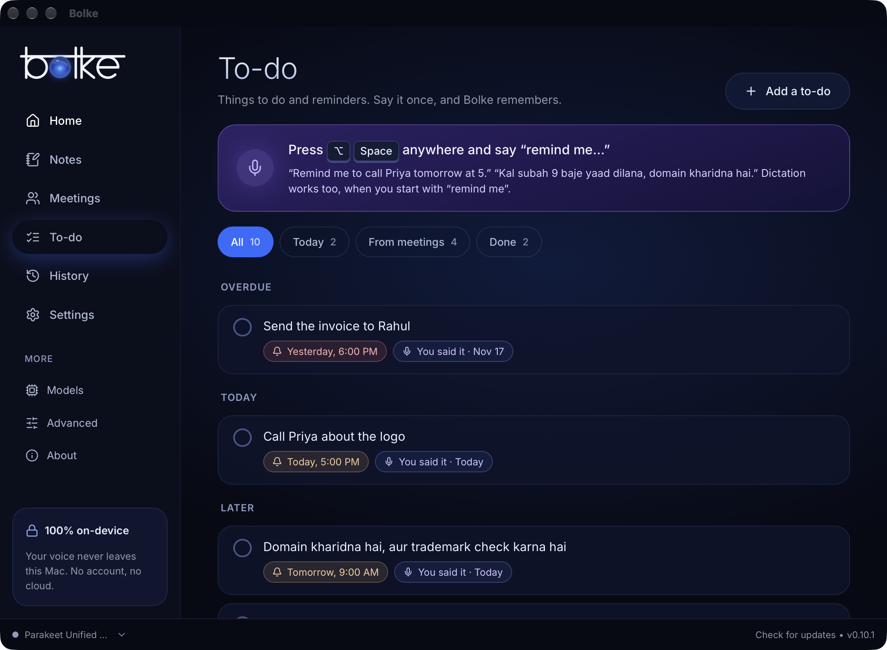</td>
    <td width="50%">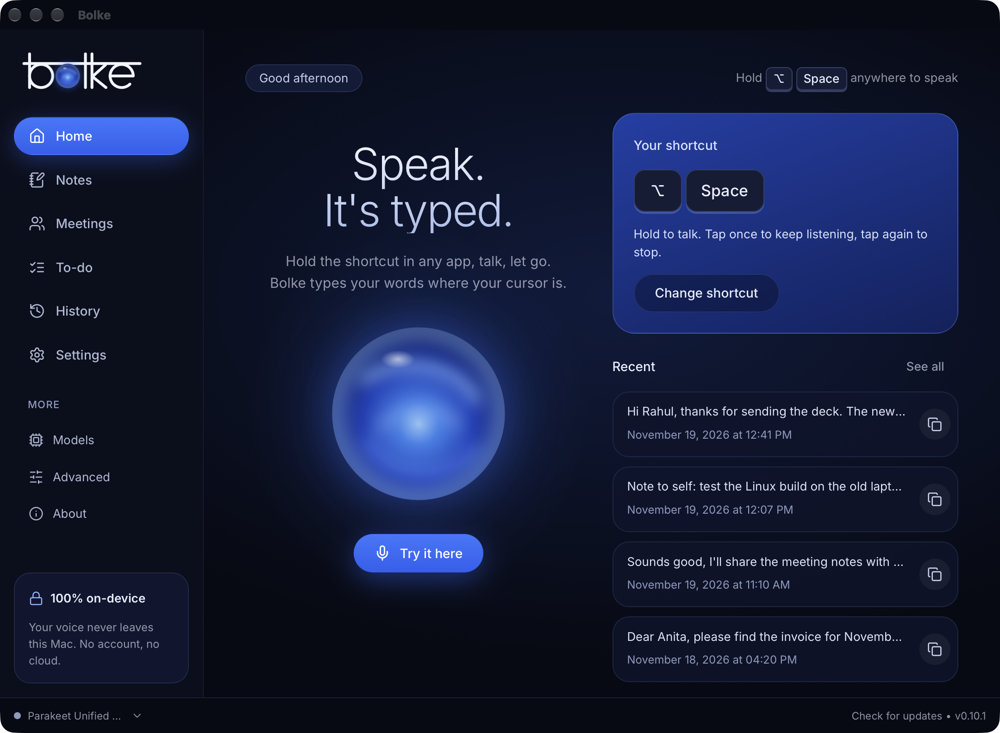</td>
  </tr>
  <tr>
    <td align="center"><sub><b>To-do:</b> what you asked Bolke to remember, and when</sub></td>
    <td align="center"><sub><b>Home:</b> your shortcut and recent dictations at a glance</sub></td>
  </tr>
  <tr>
    <td width="50%">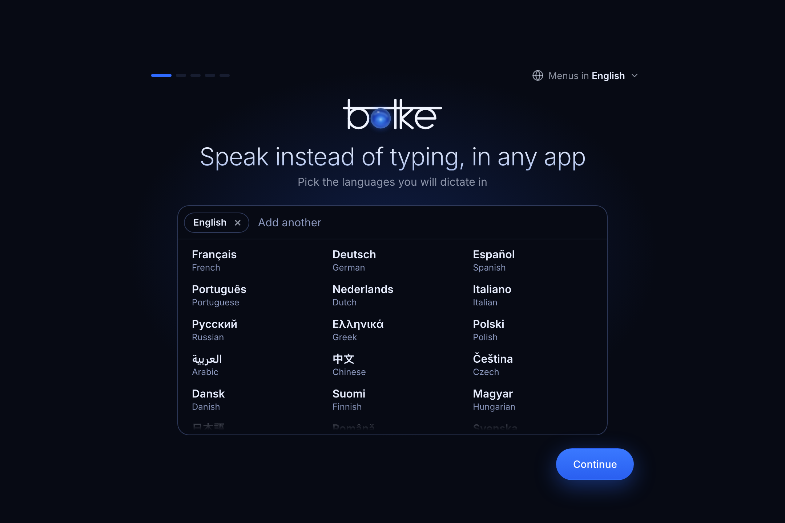</td>
    <td width="50%">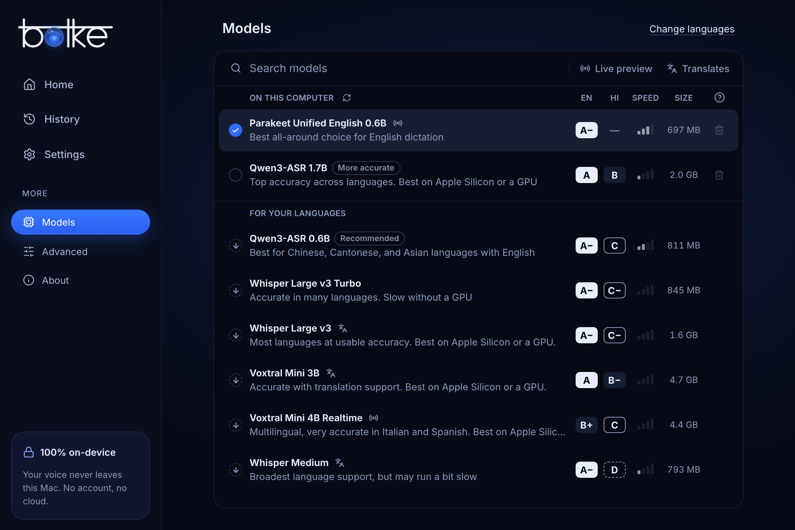</td>
  </tr>
  <tr>
    <td align="center"><sub><b>Welcome:</b> pick the languages you speak</sub></td>
    <td align="center"><sub><b>Models:</b> compare accuracy, speed and size</sub></td>
  </tr>
  <tr>
    <td width="50%"></td>
    <td width="50%"></td>
  </tr>
  <tr>
    <td align="center"><sub><b>History:</b> everything you've dictated, ready to copy or replay</sub></td>
    <td align="center"><sub><b>Settings:</b> shortcuts, microphone and sounds</sub></td>
  </tr>
  <tr>
    <td width="50%">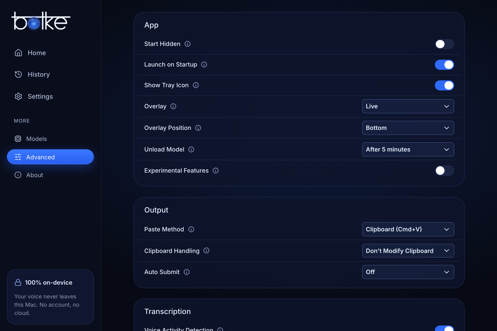</td>
    <td width="50%" align="center">
      <br><br>
      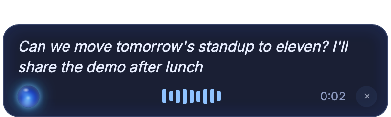
    </td>
  </tr>
  <tr>
    <td align="center"><sub><b>Advanced:</b> overlay, pasting and more</sub></td>
    <td align="center"><sub><b>Recording bubble:</b> floats over your work while you speak</sub></td>
  </tr>
</table>

## Why Bolke

- 🔒 **Your words stay yours.** Speech recognition runs on your computer. There's no account, and nothing is sent anywhere.
- ✈️ **Works offline.** After the first model download, Bolke needs no internet.
- 🌍 **Many languages.** Choose from over 20 speech models, from small and fast to large and accurate. Bolke can also turn speech in another language into English text.
- ⚡ **Fast.** Bolke uses your computer's graphics chip when it can, so the text appears moments after you stop.
- 💸 **Free and open source.** No subscription, no limits, MIT licensed.

## Platforms

| Platform    | Status                                                                                      |
| ----------- | ------------------------------------------------------------------------------------------- |
| **Windows** | ✅ Ready to try (Windows 10 and 11, 64-bit). [Install](#install-on-windows)                 |
| **Linux**   | ✅ Ready to try (64-bit). [Install](#install-on-linux)                                      |
| **macOS**   | ✅ Ready to try (macOS 10.15 or newer; Apple Silicon and Intel). [Install](#install-on-mac) |

## Install on Mac

1. Download the one for your Mac:
   - **Apple Silicon (M1, M2, M3, M4 and newer):** [Bolke-mac-apple-silicon.dmg](https://github.com/mrsoundmind/bolke/releases/latest/download/Bolke-mac-apple-silicon.dmg)
   - **Intel:** [Bolke-mac-intel.dmg](https://github.com/mrsoundmind/bolke/releases/latest/download/Bolke-mac-intel.dmg)

   Not sure which you have? Click the Apple menu → **About This Mac** and look at **Chip** (Apple M…) or **Processor** (Intel).

2. Double-click the downloaded **`.dmg`** file.
3. Drag **Bolke** into the **Applications** folder.
4. Open **Bolke** from Applications. Because Bolke isn't notarised by Apple yet, macOS says it can't check the app. Click **Done**, then go to **System Settings → Privacy & Security**, scroll down and click **Open Anyway** next to Bolke. You only need to do this once.
5. Bolke asks for two permissions: **Microphone** (to hear you) and **Accessibility** (to type the text and catch your shortcut). Allow both.
6. The first time, Bolke downloads a speech model. After that it works offline.

To dictate, hold **⌥ Space** (Option + Space), speak, and let go.

To uninstall, quit Bolke from the menu bar and drag it from Applications to the Bin.

## Install on Windows

1. Download [Bolke-windows-setup.exe](https://github.com/mrsoundmind/bolke/releases/latest/download/Bolke-windows-setup.exe) and double-click it. ([Bolke-windows.msi](https://github.com/mrsoundmind/bolke/releases/latest/download/Bolke-windows.msi) is the same app, for computers managed by an office or school.)
2. Windows may say **"Windows protected your PC"**. This is because Bolke isn't code-signed yet. Click **More info**, then **Run anyway**.
3. Follow the installer, then open **Bolke** from the Start menu.
4. The first time, Bolke asks for microphone access and downloads a speech model. After that it works offline.

To dictate, hold **Ctrl + Space**, speak, and let go. Your words are typed where your cursor is.

To uninstall, go to **Settings → Apps → Installed apps**, find **Bolke** and click **Uninstall**.

## Install on Linux

Tested on clean installs of Ubuntu 22.04 and 24.04, Debian 12, Fedora and openSUSE.

**1. Download**

1. Download the one for your system:
   - **Ubuntu, Debian, Linux Mint, Pop!\_OS, Zorin, elementary:** [Bolke-linux.deb](https://github.com/mrsoundmind/bolke/releases/latest/download/Bolke-linux.deb)
   - **Fedora, openSUSE:** [Bolke-linux.rpm](https://github.com/mrsoundmind/bolke/releases/latest/download/Bolke-linux.rpm)
   - **Bazzite, Fedora Silverblue, SteamOS or anything else:** [Bolke-linux.AppImage](https://github.com/mrsoundmind/bolke/releases/latest/download/Bolke-linux.AppImage)
2. Open your **Downloads** folder, right-click an empty space and choose **Open in Terminal**.

**2. Install: type one command in that Terminal and press Enter**

> [!IMPORTANT]
> Don't double-click the `.deb` or `.rpm` file. That opens the software store, which on some systems fails or asks you to restart without installing. The command below installs Bolke and everything it needs in one go. It asks for your password; nothing shows while you type it, which is normal.

| Your system                                | Command                                                      |
| ------------------------------------------ | ------------------------------------------------------------ |
| Ubuntu, Debian, Mint, Pop!\_OS and similar | `sudo apt install ./Bolke-linux.deb`                         |
| Fedora                                     | `sudo dnf install ./Bolke-linux.rpm`                         |
| openSUSE                                   | `sudo zypper install --allow-unsigned-rpm ./Bolke-linux.rpm` |
| AppImage (any system)                      | `chmod +x Bolke-linux.AppImage && ./Bolke-linux.AppImage`    |

On **Ubuntu 24.04**, an AppImage also needs `sudo apt install libfuse2t64` once. The `.deb` doesn't.

On **Bazzite, Silverblue and other "atomic" systems**, use the AppImage. Installing a `.rpm` there only takes effect after a restart.

**3. Open Bolke** from your apps menu (for the AppImage, double-click the file). The first time, it downloads a speech model. After that it works offline.

To dictate, hold **Ctrl + Alt + Space**, speak, and let go.

To uninstall: `sudo apt remove bolke` (Ubuntu and Debian), `sudo dnf remove Bolke` (Fedora) or `sudo zypper remove Bolke` (openSUSE). For the AppImage, delete the file.

## If something doesn't work

### On Linux

Shortcuts and typing work differently on each Linux desktop.

- **The shortcut doesn't work:** Bolke reads the keyboard itself, so its shortcuts work on Wayland and X11 alike. The .deb and .rpm installers allow this for whoever is sitting at the computer. With the AppImage, run this once in a terminal, then restart Bolke:

  ```bash
  echo 'SUBSYSTEM=="input", KERNEL=="event*", ENV{ID_INPUT_KEYBOARD}=="1", TAG+="uaccess"' | sudo tee /etc/udev/rules.d/70-bolke-keyboard.rules && sudo udevadm control --reload-rules && sudo udevadm trigger --subsystem-match=input --action=change
  ```

  Still nothing? Add a shortcut in your desktop's keyboard settings that runs `Bolke --toggle-transcription`. Press it once to start and again to stop.

- **Text isn't typed into other apps:** install a typing helper. On Wayland, install `wtype` (or `dotool` or `ydotool` on GNOME and KDE). On X11, install `xdotool`. Then restart Bolke.
- **No microphone:** allow microphone access in your system's sound or privacy settings.
- **Reminders make no sound:** install `libnotify-bin` (for the notification) and `gnome-session-canberra` or `libcanberra-gtk3-module` (for the sound).

### On Mac: the shortcut stops working

macOS turns on **Secure Input** while you type a password, and some apps (password managers, terminals) leave it on. While it's on, no app can see your shortcut.

- Bolke shows which app is causing it, when it can tell. Quit that app, or close its password field.
- In Terminal or iTerm, open the app menu and turn off **Secure Keyboard Entry**.
- If nothing helps, log out and back in.

## Logo and colours

<p align="center">
  
</p>

The logo, app icon and colours are in the [`brand`](brand) folder, as SVG and PNG.

## Building it yourself

You need [Rust](https://rustup.rs/) and [Bun](https://bun.sh/).

```bash
bun install
bun run tauri dev
```

For platform-specific setup, see [BUILD.md](BUILD.md).

Built with [Tauri](https://tauri.app) (Rust and React).

## License

MIT. See [LICENSE](LICENSE).

Bolke includes its own copies of a few open-source libraries, kept under their original licences: the keyboard, microphone and audio libraries in `src-tauri/crates/` and the model list in `packages/models/`. Each folder has its licence file.

The AI models Bolke downloads keep their own licences. For meetings: NVIDIA's Sortformer (NVIDIA Open Model License) hears who is talking when, and NVIDIA's TitaNet (CC-BY-4.0) recognises voices it has met before. Summaries are written by Qwen3 (Apache 2.0).

<br>

<p align="center">
  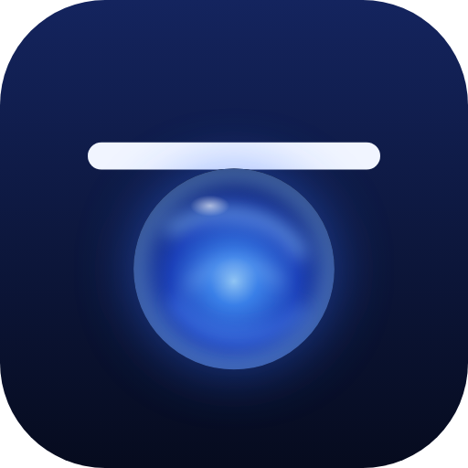
  <br>
  <b>Created by Shashank Rai</b> · <a href="https://github.com/mrsoundmind">Mr. Soundmind (@mrsoundmind)</a>
  <br>
  <sub>बोलके, just speak.</sub>
</p>
