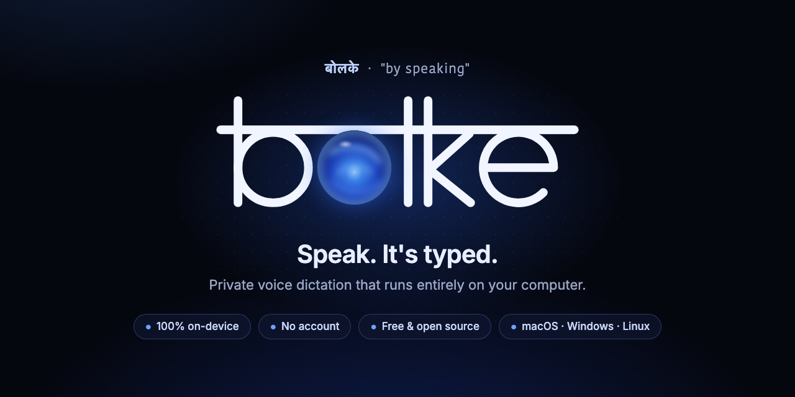
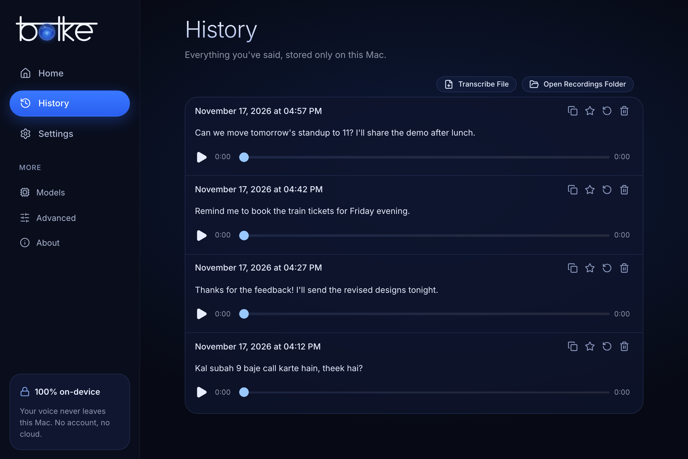
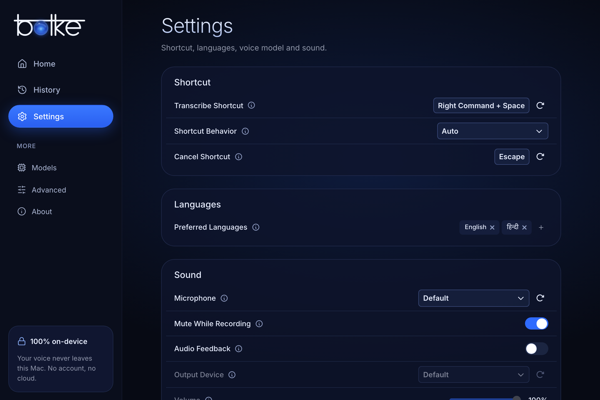

<p align="center">
  
</p>

<p align="center">
  <a href="../../actions/workflows/windows-build.yml"></a>
  <a href="../../actions/workflows/linux-build.yml"></a>
  
  <a href="LICENSE"></a>
  
</p>

<p align="center">
  <a href="#install-on-windows"><b>Windows</b></a> &nbsp;·&nbsp;
  <a href="#install-on-linux"><b>Linux</b></a> &nbsp;·&nbsp;
  <a href="#features"><b>Features</b></a> &nbsp;·&nbsp;
  <a href="#screenshots"><b>Screenshots</b></a> &nbsp;·&nbsp;
  <a href="#building-it-yourself"><b>Build it</b></a>
</p>

<br>

**Bolke** (बोलके, "by speaking") is private voice dictation for your computer. Hold a shortcut, speak, and your words are typed into whatever app you're using.

Everything runs on your own computer. Your voice never leaves it: no account, no cloud.

## How it works

1. 🎙️ **Hold** the shortcut and speak.
2. ✋ **Let go.** Bolke turns your speech into text, on your computer.
3. ⌨️ **Done.** The text is typed where your cursor is.

|     Mac     |     Windows      |         Linux          |
| :---------: | :--------------: | :--------------------: |
| **⌥ Space** | **Ctrl + Space** | **Ctrl + Alt + Space** |

## Features

- 🔒 **Private.** Speech recognition runs on your computer. Nothing you say is uploaded.
- ✈️ **Works offline.** After the first model download, no internet is needed.
- 🌍 **Many languages.** Choose from over 20 speech models, from small and fast to large and accurate.
- ⌨️ **Types anywhere.** Email, chat, documents, the browser: wherever your cursor is.
- 🕘 **History.** Look back at what you dictated, copy it again, or replay the recording.
- 🎛️ **Your shortcut.** Hold to talk, or press once to start and again to stop.
- 💸 **Free and open source.** No account, no subscription, MIT licensed.

## Screenshots

<p align="center">
  
</p>

<table>
  <tr>
    <td width="50%"></td>
    <td width="50%"></td>
  </tr>
  <tr>
    <td align="center"><sub><b>History:</b> everything you've dictated</sub></td>
    <td align="center"><sub><b>Settings:</b> shortcut, microphone and model</sub></td>
  </tr>
</table>

## Platforms

| Platform    | Status                                                                      |
| ----------- | --------------------------------------------------------------------------- |
| **Windows** | ✅ Ready to try (Windows 10 and 11, 64-bit). [Install](#install-on-windows) |
| **Linux**   | ✅ Ready to try (64-bit). [Install](#install-on-linux)                      |
| **macOS**   | 🛠️ In development                                                           |

## Install on Windows

1. Sign in to GitHub and open the [Windows Build](../../actions/workflows/windows-build.yml) page.
2. Click the newest run that has a green tick.
3. Scroll down to **Artifacts** and click **bolke-x86_64-pc-windows-msvc** to download it.
4. Open the downloaded zip and drag its contents out to a folder.
5. Double-click the installer that ends in **`-setup.exe`**. (The `.msi` file is the same app, for computers managed by an office or school.)
6. Windows may say **"Windows protected your PC"**. This is because Bolke isn't code-signed yet. Click **More info**, then **Run anyway**.
7. Follow the installer, then open **Bolke** from the Start menu.
8. The first time, Bolke asks for microphone access and downloads a speech model. After that it works offline.

To dictate, hold **Ctrl + Space**, speak, and let go. You can change the shortcut in Bolke's settings. Your words are typed where your cursor is.

To uninstall, go to **Settings → Apps → Installed apps**, find **Bolke** and click **Uninstall**.

## Install on Linux

1. Sign in to GitHub and open the [Linux Build](../../actions/workflows/linux-build.yml) page.
2. Click the newest run that has a green tick.
3. Scroll down to **Artifacts** and download the one for your system:
   - **Ubuntu, Debian, Linux Mint, Pop!\_OS:** `bolke-ubuntu-22.04-x86_64-unknown-linux-gnu` (a `.deb` file)
   - **Fedora, openSUSE:** `bolke-ubuntu-24.04-x86_64-unknown-linux-gnu` (the `.rpm` file)
   - **Any other system:** `bolke-ubuntu-24.04-x86_64-unknown-linux-gnu` (the `.AppImage` file)
4. Unzip it, then install:
   - `.deb`: `sudo apt install ./Bolke_*.deb`
   - `.rpm`: `sudo dnf install ./Bolke-*.rpm`
   - `.AppImage`: `chmod +x Bolke_*.AppImage`, then double-click it.
5. Open **Bolke** from your apps menu. The first time, it downloads a speech model. After that it works offline.

To dictate, hold **Ctrl + Alt + Space**, speak, and let go.

### Linux setup

Shortcuts and typing work differently on each Linux desktop.

- **The shortcut doesn't work (common on Wayland):** add a shortcut in your desktop's keyboard settings that runs `Bolke --toggle-transcription`. Press it once to start and again to stop.
- **Text isn't typed into other apps:** install a typing helper. On Wayland, install `wtype` (or `dotool` or `ydotool` on GNOME and KDE). On X11, install `xdotool`. Then restart Bolke.
- **No microphone:** allow microphone access in your system's sound or privacy settings.

## If the shortcut stops working on Mac

macOS turns on **Secure Input** while you type a password, and some apps (password managers, terminals) leave it on. While it's on, no app can see your shortcut.

- Bolke shows which app is causing it, when it can tell. Quit that app, or close its password field.
- In Terminal or iTerm, open the app menu and turn off **Secure Keyboard Entry**.
- If nothing helps, log out and back in.

## Building it yourself

You need [Rust](https://rustup.rs/) and [Bun](https://bun.sh/).

```bash
bun install
bun run tauri dev
```

For platform-specific setup, see [BUILD.md](BUILD.md).

Built with [Tauri](https://tauri.app) (Rust and React).

## License

MIT. See [LICENSE](LICENSE).

Bolke includes its own copies of a few open-source libraries, kept under their original licences: the keyboard, microphone and audio libraries in `src-tauri/crates/` and the model list in `packages/models/`. Each folder has its licence file.

<br>

<p align="center">
  <sub>Made with care by <a href="https://github.com/mrsoundmind">@mrsoundmind</a> · बोलके, just speak.</sub>
</p>
