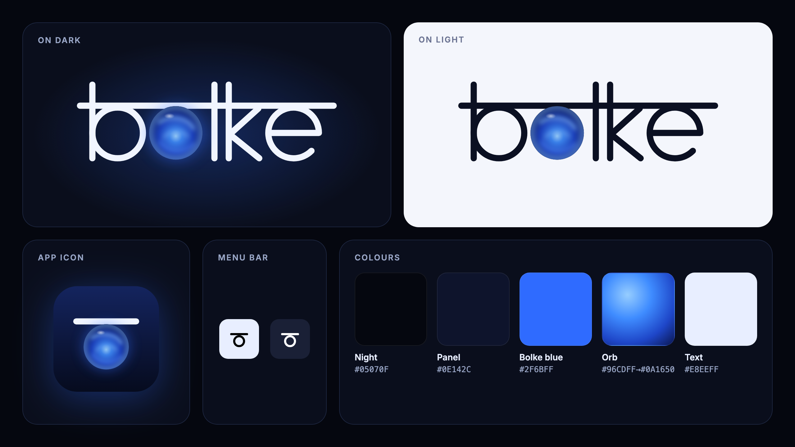

# Bolke logo and colours

  

The Bolke wordmark is custom-drawn: the "o" is a glowing blue orb, and a single bar runs across the top of the letters, like the top line of Devanagari script (बोलके). There is no font file behind it.

## Files

| File                                                                                       | Use it for                               |
| ------------------------------------------------------------------------------------------ | ---------------------------------------- |
| [`bolke-logo-white.svg`](bolke-logo-white.svg) / [`.png`](bolke-logo-white.png)            | The logo on dark backgrounds             |
| [`bolke-logo-dark.svg`](bolke-logo-dark.svg) / [`.png`](bolke-logo-dark.png)               | The logo on light backgrounds            |
| [`bolke-app-icon.svg`](bolke-app-icon.svg)                                                 | The app icon, as a vector                |
| [`bolke-app-icon-1024.png`](bolke-app-icon-1024.png), [`-512.png`](bolke-app-icon-512.png) | The app icon, as images                  |
| [`bolke-menubar-icon.svg`](bolke-menubar-icon.svg) / [`.png`](bolke-menubar-icon.png)      | One-colour icon for the menu bar or tray |
| [`bolke-brand-sheet.png`](bolke-brand-sheet.png)                                           | Everything on one page                   |

Use the SVG files wherever you can. They stay sharp at any size.

## Colours

| Name       | Value                                   |
| ---------- | --------------------------------------- |
| Night      | `#05070F` (background)                  |
| Panel      | `#0A0E1C`, `#0E142C`                    |
| Bolke blue | `#2F6BFF` (buttons and links)           |
| Orb        | `#96CDFF → #3F8CFF → #1E46C8 → #0A1650` |
| Text       | `#E8EEFF`, secondary `#9AA7C7`          |

The interface uses [Inter](https://rsms.me/inter/). बोलके is set in Noto Sans Devanagari.

## Please

- Don't stretch, recolour or redraw the logo.
- Leave space around it, at least the width of the orb.
- Use the white logo on dark backgrounds and the dark logo on light ones.

Logo and icons © Shashank Rai.
